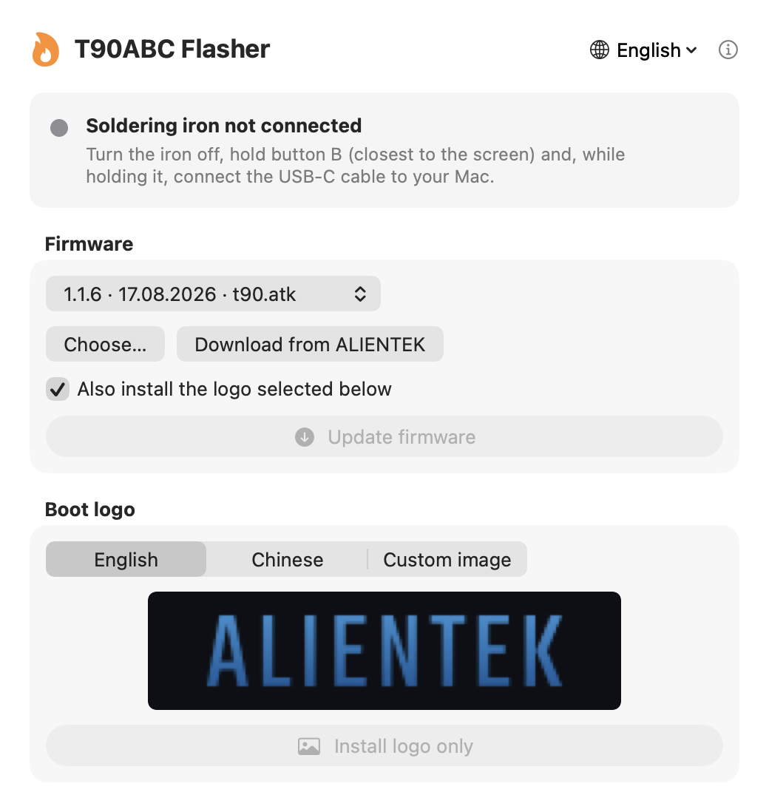

# T90ABC Flasher for macOS

**Update the firmware and change the boot logo of ALIENTEK T90A / T90B / T90C soldering irons on a Mac — no Windows needed.**

[Русская версия](README.ru.md)



The official ALIENTEK updater (`ATK_T90.exe`) runs only on Windows. T90ABC Flasher is a small native Mac app that uses the same USB protocol, so you can update your iron straight from macOS.

- Firmware update from the official ALIENTEK package (ZIP, folder or `.atk`)
- Change the boot logo: English, Chinese or **your own image**
- Shows the installed firmware version (e.g. 1.1.6)
- Tells you when a new version of the app is available
- Any Apple Silicon Mac (M1 and newer, including M5) and Intel, macOS 13 Ventura or newer
- English, Русский, Українська, Español, Português, Deutsch, 中文

> Unofficial tool, not affiliated with ALIENTEK. Use at your own risk.

## Download

Get **T90ABC-Flasher-macOS.zip** from the [latest release](../../releases/latest), unzip it and drag **T90ABC Flasher** to *Applications*.

### First launch

The app is not signed with a paid Apple certificate yet, so macOS will block it the first time. This is normal for free open-source apps. You only need to do this once:

1. Open **T90ABC Flasher**. macOS shows a warning — click **Done** (or **OK**).
2. Open **System Settings → Privacy & Security**, scroll down and click **Open Anyway** next to “T90ABC Flasher”.
3. Confirm with your password. From now on the app opens normally.

If there is no **Open Anyway** button, run this once in Terminal:

```bash
xattr -dr com.apple.quarantine "/Applications/T90ABC Flasher.app"
```

## How to use

1. Download the official firmware package from [en.alientek.com/download](https://en.alientek.com/download/p-0-10.html) — look for **T90ABC Smart Soldering Iron** (one package for T90A, T90B and T90C).
2. Open T90ABC Flasher and click **Choose…** (or drag the ZIP into the window).
3. Turn the iron **off**, hold **button B** (closest to the screen) and, while holding it, connect the USB‑C cable to your Mac. The dot turns green: *Ready to update*.
4. Click **Update firmware** — or **Install logo only** to change just the boot picture.
5. Wait for **Done**, unplug the cable and turn the iron on.

### Custom boot logo

Choose **Custom image** and pick any picture. The best size is **160×40 px**; other sizes are scaled to fit on a black background. The preview shows exactly what will appear on the iron.

## Troubleshooting

| Problem | Solution |
|---|---|
| “Soldering iron not connected” | Use a USB‑C **data** cable (some cables are charge-only). Hold button B *before* plugging in. |
| “Not in update mode” | Unplug, hold button B, plug in again. |
| Auto-rotation works incorrectly after an update | Choose the *auto-rotation fix* in the firmware list, flash it once, then flash the latest firmware again. |
| The logo reset to Chinese after a firmware update | Keep **Also install the logo** checked when updating. |

## Support

T90ABC Flasher is free. If it saved you from looking for a Windows PC, you can buy me a coffee ☕

- **Ko-fi:** *add your link*
- **Boosty:** *add your link*
- **USDT (TRC20):** `add your address`
- **BTC:** `add your address`

## Build from source

Requires Xcode Command Line Tools (`xcode-select --install`).

```bash
./build.sh
```

The app and the ZIP appear in `dist/`. Edit the links at the top of `build.sh` first.

To publish an update: raise `VERSION` in `build.sh`, run `./build.sh` and create a GitHub release tagged `v<VERSION>` with `dist/T90ABC-Flasher-macOS.zip` attached. Installed apps will offer the update on next launch.

## How it works

The iron's bootloader is a USB HID device (VID `0x19F5`, PID `0x3245`). Frames are `[0xAF][cmd][seq][len][data…][checksum]`, replies start with `0xDF`. Commands: `0x10` device info, `0x11` block header, `0x12` start, `0x13` data (32‑byte chunks for firmware, 40 for the logo), `0x14` end, `0x15` finish. Firmware data in `.atk` files is sent as is — the iron decrypts it. The logo block is `"ATKLOGO\0"`, width, height and RGB565 pixels, each byte inverted. See [`Sources/Protocol.swift`](Sources/Protocol.swift).

No firmware files are included in this repository; they belong to ALIENTEK.

## License

[MIT](LICENSE)
