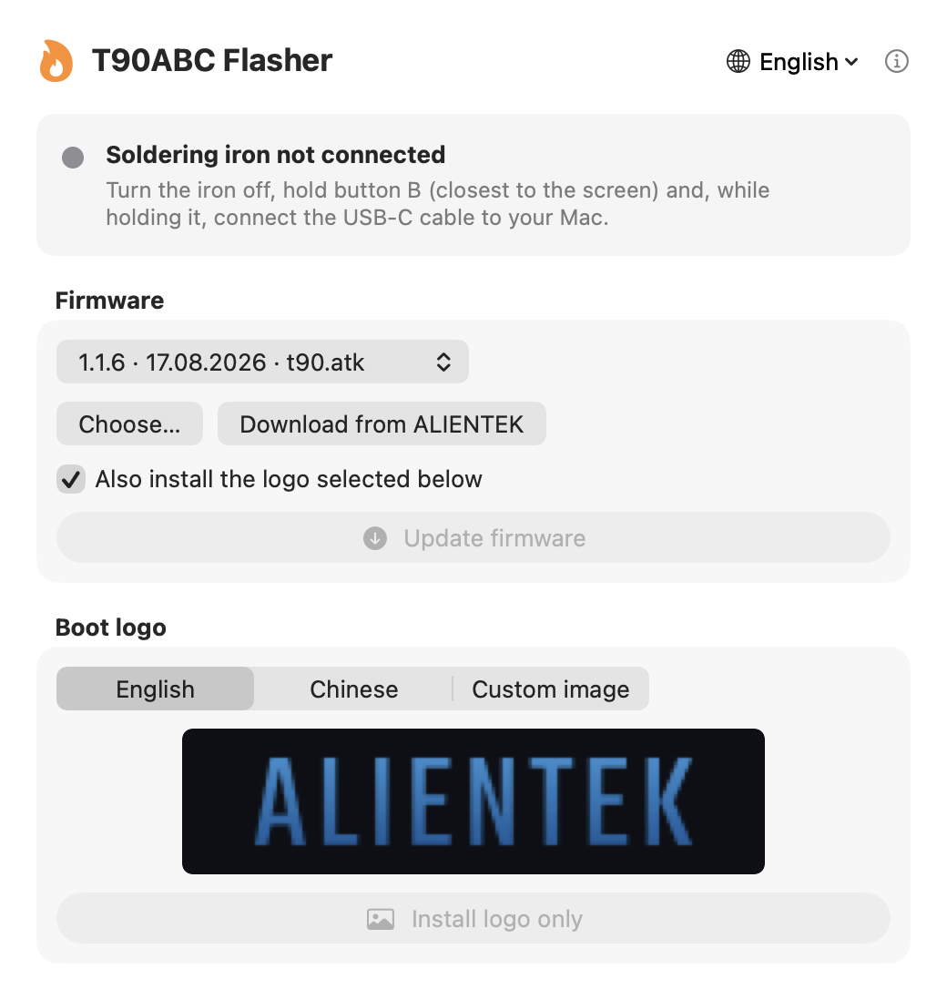

# T90ABC Flasher для macOS

**Прошивка и смена логотипа паяльников ALIENTEK T90A / T90B / T90C на Mac — без Windows.**

[English version](README.md)



Официальная программа ALIENTEK (`ATK_T90.exe`) работает только на Windows. T90ABC Flasher — небольшое приложение для Mac, которое общается с паяльником по тому же USB-протоколу.

- Обновление прошивки из официального архива ALIENTEK (ZIP, папка или `.atk`)
- Смена картинки при включении: английский, китайский логотип или **своя картинка**
- Показывает, какая версия прошивки стоит сейчас (например, 1.1.6)
- Сообщает, когда выходит новая версия программы
- Любой Mac на Apple Silicon (M1 и новее, включая M5) и Intel, macOS 13 Ventura и новее
- English, Русский, Українська, Español, Português, Deutsch, 中文

> Неофициальная программа, не связана с ALIENTEK. Используйте на свой риск.

## Скачать

Скачайте **T90ABC-Flasher-macOS.zip** в разделе [последний релиз](../../releases/latest), распакуйте и перетащите **T90ABC Flasher** в «Программы».

### Первый запуск

Приложение пока не подписано платным сертификатом Apple, поэтому при первом запуске macOS его заблокирует. Это нормально для бесплатных программ с открытым кодом. Сделать нужно один раз:

1. Откройте **T90ABC Flasher**. Появится предупреждение — нажмите **Готово** (или **OK**).
2. Откройте **Системные настройки → Конфиденциальность и безопасность**, прокрутите вниз и нажмите **Всё равно открыть** напротив «T90ABC Flasher».
3. Подтвердите паролем. Дальше приложение открывается как обычно.

Если кнопки **Всё равно открыть** нет, выполните один раз в Терминале:

```bash
xattr -dr com.apple.quarantine "/Applications/T90ABC Flasher.app"
```

## Как пользоваться

1. Скачайте официальный архив прошивки с [en.alientek.com/download](https://en.alientek.com/download/p-0-10.html) — ищите **T90ABC Smart Soldering Iron** (один архив для T90A, T90B и T90C).
2. Откройте T90ABC Flasher и нажмите **Выбрать…** (или перетащите ZIP в окно).
3. **Выключите** паяльник, зажмите **кнопку B** (ближе к экрану) и, не отпуская, подключите USB‑C кабель к Mac. Точка станет зелёной: «Паяльник готов к обновлению».
4. Нажмите **Обновить прошивку** — или **Поставить только логотип**, если нужно сменить только картинку.
5. Дождитесь **Готово**, отключите кабель и включите паяльник.

### Своя картинка при включении

Выберите **Своя картинка** и укажите любое изображение. Лучший размер — **160×40 пикселей**, остальные вписываются по центру на чёрном фоне. Превью показывает ровно то, что появится на паяльнике.

## Если что-то не так

| Проблема | Решение |
|---|---|
| «Паяльник не подключён» | Нужен USB‑C кабель **с передачей данных** (некоторые только заряжают). Зажимайте кнопку B *до* подключения. |
| «Не в режиме обновления» | Отключите, зажмите кнопку B, подключите снова. |
| После обновления неправильно работает авто-поворот | Выберите в списке *исправление авто-поворота*, прошейте его один раз, затем снова последнюю прошивку. |
| После обновления логотип снова китайский | При обновлении оставляйте галочку **Заодно поставить логотип**. |

## Поддержать

T90ABC Flasher бесплатный. Если программа избавила вас от поиска компьютера с Windows, можно угостить автора кофе ☕

- **Boosty:** *добавьте ссылку*
- **Ko-fi:** *добавьте ссылку*
- **USDT (TRC20):** `добавьте адрес`
- **BTC:** `добавьте адрес`

## Сборка из исходников

Нужны Xcode Command Line Tools (`xcode-select --install`).

```bash
./build.sh
```

Приложение и ZIP появятся в папке `dist/`. Перед сборкой укажите свои ссылки в начале `build.sh`.

Как выпустить обновление: увеличьте `VERSION` в `build.sh`, запустите `./build.sh` и создайте на GitHub релиз с тегом `v<VERSION>`, приложив `dist/T90ABC-Flasher-macOS.zip`. Установленные программы предложат обновиться при следующем запуске.

Файлы прошивки в репозиторий не входят — они принадлежат ALIENTEK.

## Лицензия

[MIT](LICENSE)
